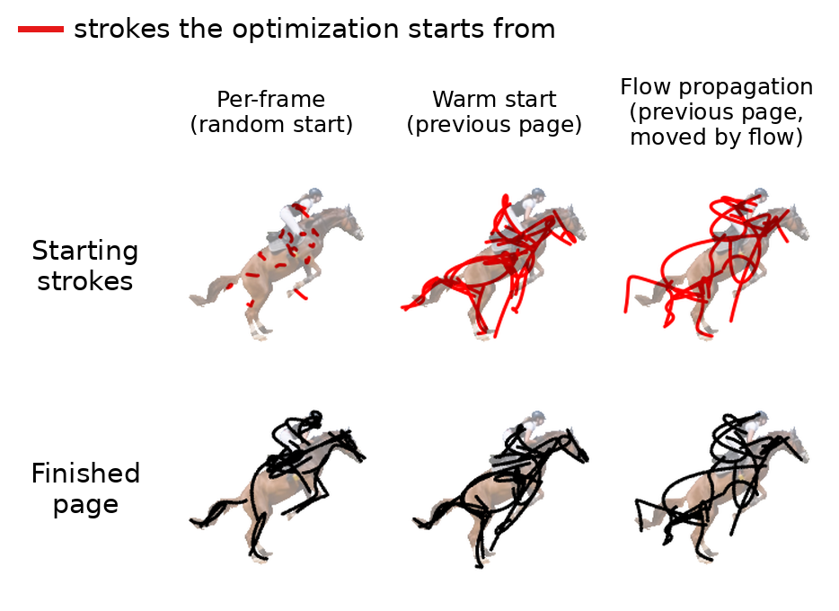
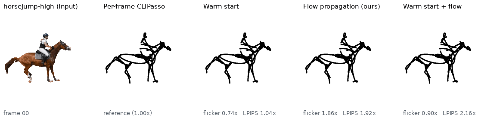

# Is optical flow needed for stable sketch flipbooks?

A course project for Modern Computer Vision at the Technion, by Rona Lavi, Ron Libman, Yamit Ehrlich and Sophie
Danilov. The full write-up is in [the report](report/report.pdf).

## The idea

We wanted to turn a short video into a flipbook: a stack of simple line drawings that comes to life when you flip
through it. To draw each page we used [CLIPasso](https://arxiv.org/abs/2202.05822), which sketches an object with
just a handful of curved strokes.

Drawing every frame on its own gives nice pages, but the flipbook flickers. Each page starts from a fresh, random set
of strokes, so the lines land somewhere new every time, even when the object barely moves.

A natural fix is to draw the pages in order and start each one from the page before it, after nudging its strokes
along the optical flow, the estimated motion of every pixel between two frames. Earlier work on sketch videos
([Zheng et al.](https://arxiv.org/abs/2311.15306)) set optical flow aside, worried that small errors would pile up
from page to page, but never tested it. So we did.

## What we compared

We tried three ways of starting each new page. The red strokes above show where each one starts; the black ones are
the finished page.

- Per-frame: draw every page from scratch. This is plain CLIPasso, and it is our baseline.
- Warm start: begin from the previous page and adjust it a little.
- Flow propagation, the method we proposed: first move the previous page along the optical flow, then adjust it.
  It also redraws strokes that fall on parts of the object that just became hidden, keeps strokes close to where the
  flow put them, and gives the drawing a longer touch-up every few pages.

To see what the flow itself adds, we also ran flow propagation with the flow step switched off, and the warm start
with only the flow step added. We picked all settings on one clip, of a dog, and then left them alone for the
three test clips: a swan, a camel and a jumping horse, each drawn three times with different random starts.

## What we found

The simplest idea won. Starting each page from the previous one cut flicker by 43%, kept the drawings almost as close
to the video, and needed about 13 times fewer optimization steps for each new page.

Optical flow didn't help on top of that. Our flow method removed less flicker than the warm start and drifted
furthest from the video, and adding the flow to the warm start left flicker where it was while making the drawings
less faithful. The jumping horse shows why: when the motion is fast and parts of the horse get hidden, the flow is
wrong for some of the strokes, and they get dragged across the page.

The worry about piling-up errors turned out to be half right. Errors do build up when the strokes are forced to
follow a prediction such as the flow, but not with the plain warm start.

## What's in this repository

The drawing, evaluation and plotting code is in `src/` and `scripts/`, and the settings for every experiment are in
`configs/`. The results, meaning per-clip measurements, summary tables, figures and animations, are in `results/`, and
the report with its LaTeX source is in `report/`. CLIPasso and DiffVG themselves are not included; `patches/` holds
the small changes we made to them.

## Credits

The project builds on [CLIPasso](https://github.com/yael-vinker/CLIPasso) (Vinker et al., SIGGRAPH 2022) and
[DiffVG](https://github.com/BachiLi/diffvg) (Li et al., SIGGRAPH Asia 2020), and uses
[RAFT](https://github.com/princeton-vl/RAFT) (Teed and Deng, ECCV 2020),
[GMFlow / UniMatch](https://github.com/autonomousvision/unimatch) (Xu et al., TPAMI 2023),
[CLIP](https://github.com/openai/CLIP), [LPIPS](https://github.com/richzhang/PerceptualSimilarity) and the
[DAVIS 2017](https://davischallenge.org/) videos (Pont-Tuset et al.).
