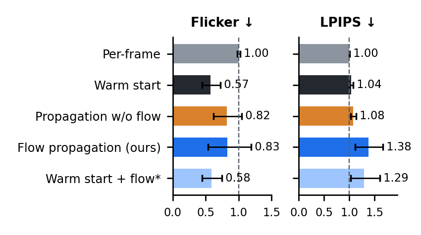
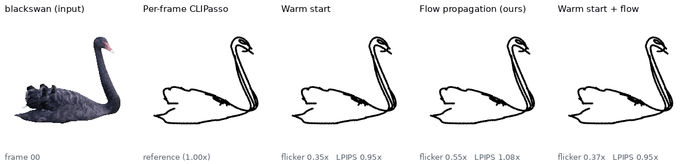

# Is Optical Flow Needed for Stable Sketch Flipbooks?

Course project, Modern Computer Vision (Technion).
Report: [`report/report.pdf`](report/report.pdf) · Revised proposal: [`report/proposal.pdf`](report/proposal.pdf)

A flipbook made from a video should look like the video on every page and should not flicker when flipped. We draw
each page as a simple line drawing with 16 curved strokes, using [CLIPasso](https://arxiv.org/abs/2202.05822). When
every frame is drawn separately, the strokes land in different places on consecutive pages, and the flipbook
flickers.

A simple remedy is to start each drawing from the previous one, after moving its strokes along the optical flow (the
estimated motion of each pixel between frames). Zheng et al. ([Sketch Video Synthesis](https://arxiv.org/abs/2311.15306))
set optical flow aside for this purpose, warning that its errors might accumulate, but did not test it. We test it: we build such a method
step by step, measure what each step adds, and evaluate on three clips that were not used to choose any setting.

**Result.** The full flow-based method did not beat the simplest step: starting each drawing
from the previous one reduced flicker by 43%, with almost the same quality and 13 times fewer
optimization steps for every frame after the first. Optical flow
did not improve on this, and it broke the drawings when the motion was fast and partly hidden.

## Methods compared

All methods draw the first frame with CLIPasso and then draw the remaining frames in order. A *warm start* means
starting each drawing from the finished drawing of the previous frame instead of from scratch, and only adjusting it
briefly. The figure shows how each method starts the next drawing (red: starting strokes over the new frame) and the
result after optimization.


| Method | How the next drawing is made | Run name in the code |
| --- | --- | --- |
| Per-frame | CLIPasso from scratch, 2,001 iterations | `A` |
| Warm start | Start from the previous drawing, refine for 150 iterations | `B` |
| Flow propagation (proposed) | Warm start, plus: move the strokes with the optical flow, re-place strokes in hidden regions, keep strokes near their start with a penalty λ, and refine a keyframe every K frames | `C_lam<λ>_K<K>` |
| Propagation without flow | Flow propagation without the flow move (the control) | `BL_lam<λ>_K<K>` |
| Warm start + flow | Warm start plus the flow move only (exploratory, added after the test results) | `BF` |

λ and K were chosen on one development clip (DAVIS `dog`) only; the chosen settings are in
[`configs/settings.yaml`](configs/settings.yaml). They were not changed for the test clips (`blackswan`, `camel`,
`horsejump-high`, three random seeds each).

## Measures

- Flicker: how far the strokes move beyond the motion of the object. The drawing of one frame is shifted by the video's
  motion to the next frame, and we measure the average distance between its strokes and those of the next drawing.
  The shift uses GMFlow, a flow model that none of the methods use.
- Fidelity: how much a drawing resembles its frame, measured by LPIPS (lower is closer) and CLIP ViT-L/14 similarity
  (higher is closer).
- Cost: iterations per frame.

Every number is relative to per-frame drawing on the same clip, so per-frame drawing scores 1.00.

## Results

Test clips, mean of nine runs (95% confidence interval for flicker):

| Method | Flicker (lower is better) | LPIPS (lower is better) | CLIP (higher is better) | Iterations per frame |
| --- | --- | --- | --- | --- |
| Per-frame | 1.00 | 1.00 | 1.00 | 2001 |
| Per-frame, stopped after 150 iterations | 2.28 [2.11, 2.48] | 1.25 | 0.90 | 150 |
| Warm start | **0.57** [0.44, 0.72] | **1.04** | 0.99 | 150 |
| Propagation without flow | 0.82 [0.62, 1.04] | 1.08 | 1.00 | 196 |
| Flow propagation (proposed) | 0.83 [0.54, 1.19] | 1.38 | 0.96 | 196 |
| Warm start + flow (exploratory) | 0.58 [0.44, 0.75] | 1.29 | 0.98 | 150 |

- Flow propagation removed less flicker than the warm start (0.83) and was the least faithful method (LPIPS 1.38).
- The warm start reduced flicker by 43% with almost the same quality. Per-frame drawing stopped after the same 150
  iterations flickers four times as much, so the gain comes from the starting point.
- Errors do not build up with the plain warm start. They do build up when strokes are pulled toward a predicted
  position or moved by the flow.



The video next to per-frame drawing, warm start, flow propagation and warm start + flow, at flipbook speed (numbers
are for this clip and seed):




Per-frame drawing against flow propagation only: `results/figures/gifs/*_vs.gif`; half-speed copies:
`*_slow.gif`. The effect of λ and K: [`results/figures/test/tradeoff.png`](results/figures/test/tradeoff.png). Full tables: [`results/summary/test/summary.md`](results/summary/test/summary.md) (test clips) and
[`results/summary/dev/summary.md`](results/summary/dev/summary.md) (development clip).

## Reproducing the results

Setup (Linux, NVIDIA GPU):
```
python3.10 -m venv env && env/bin/pip install -r requirements.txt   # torch 2.11 + cu128
git clone https://github.com/yael-vinker/CLIPasso.git third_party/CLIPasso && (cd third_party/CLIPasso && git checkout 92262f7 && git apply ../../patches/clipasso_torch2.patch)
gdown "https://drive.google.com/uc?id=1ao1ovG1Qtx4b7EoskHXmi2E9rp5CHLcZ" -O third_party/CLIPasso/U2Net_/saved_models/u2net.pth
git clone https://github.com/BachiLi/diffvg.git third_party/diffvg && (cd third_party/diffvg && git checkout 85802a7 && git submodule update --init --recursive && git apply ../../patches/diffvg_cuda12.patch)
(cd third_party/diffvg && DIFFVG_CUDA=1 python setup.py install)   # needs nvcc >= 12.8 for Blackwell GPUs
git clone https://github.com/autonomousvision/unimatch.git third_party/unimatch   # commit 943a990
curl -L -o third_party/unimatch/pretrained/gmflow-scale2-regrefine6-mixdata-train320x576-4e7b215d.pth \
  https://s3.eu-central-1.amazonaws.com/avg-projects/unimatch/pretrained/gmflow-scale2-regrefine6-mixdata-train320x576-4e7b215d.pth
curl -L -o data/davis/DAVIS-2017-trainval-480p.zip https://data.vision.ee.ethz.ch/csergi/share/davis/DAVIS-2017-trainval-480p.zip
```

Run (GPU):
```
python scripts/prepare_clip.py --clip dog              # frames, RAFT and GMFlow flows -> data/clips/dog
python scripts/run_sequence.py --clip dog --method C --motion flow --lam 1.6e-3 --K 6 --seed 0   # one run
python scripts/launch.py configs/test.yaml --submit    # a whole experiment on Slurm (resubmitting resumes)
python scripts/evaluate.py --clip blackswan            # metrics -> results/eval/blackswan
```

Tables, figures, GIFs and the report PDFs from the evaluated runs (no GPU needed):
```
scripts/rebuild_outputs.sh
```

The experiments in the report are, in order: `configs/dev.yaml` and `configs/dev_k.yaml` (development clip),
`configs/select.yaml` (choice of test clips), `configs/test_A.yaml` and `configs/test.yaml` (test clips), and
`configs/explore_bf*.yaml` (the exploratory warm start + flow).

## Repository

| Path | Content |
| --- | --- |
| `src/clipasso_runner.py` | CLIPasso optimization with warm start, regularizer, snapshots and resume |
| `src/flow.py`, `src/eval_flow.py` | RAFT (used by the methods) and GMFlow (used only for evaluation) |
| `src/names.py` | Display names of the methods in figures and tables |
| `scripts/prepare_clip.py` | DAVIS clip to 224×224 frames on white, optical flows, occlusion masks |
| `scripts/run_sequence.py` | Runs one method on one clip, frame by frame |
| `scripts/launch.py`, `worker.py`, `slurm_worker.sh` | Runs a whole experiment from `configs/*.yaml` on Slurm |
| `scripts/evaluate.py`, `aggregate.py` | Metrics per run; tables with confidence intervals |
| `scripts/make_figures.py`, `make_report_figures.py`, `make_gifs.py` | Figures and comparison GIFs |
| `scripts/make_flipbook.py` | Printable flipbook PDF of one run |
| `scripts/rebuild_outputs.sh` | Rebuilds every table, figure, GIF and PDF from the evaluated runs |
| `configs/` | Experiment definitions and the chosen settings (`settings.yaml`) |
| `patches/` | Patches for CLIPasso (PyTorch 2) and DiffVG (CUDA 12) |
| `results/` | Per-clip evaluations, summaries, figures, GIFs, clip previews, timing |
| `report/` | Report and proposal (LaTeX sources, figures, PDFs) |

## Credits

Built on [CLIPasso](https://github.com/yael-vinker/CLIPasso) (Vinker et al., SIGGRAPH 2022) and
[DiffVG](https://github.com/BachiLi/diffvg) (Li et al., SIGGRAPH Asia 2020), used through the patches in `patches/`;
[RAFT](https://github.com/princeton-vl/RAFT) via torchvision (Teed and Deng, ECCV 2020);
[GMFlow / UniMatch](https://github.com/autonomousvision/unimatch) (Xu et al., TPAMI 2023);
[CLIP](https://github.com/openai/CLIP), [LPIPS](https://github.com/richzhang/PerceptualSimilarity), and the
[DAVIS 2017](https://davischallenge.org/) videos (Pont-Tuset et al.).
